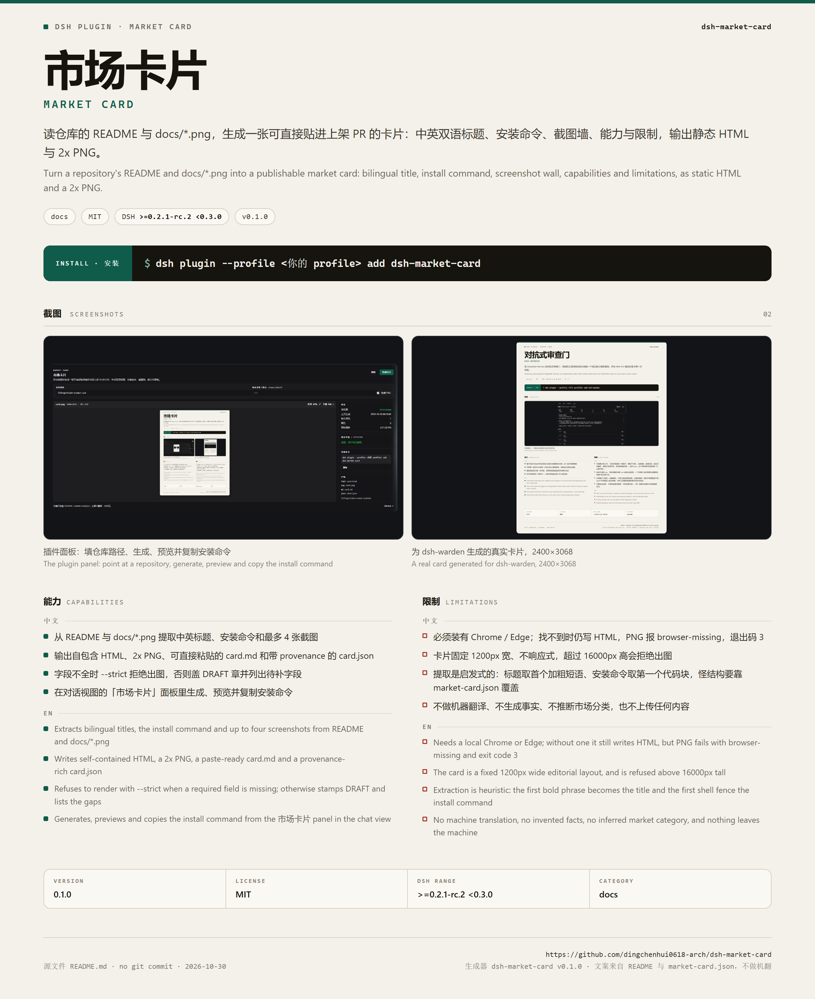
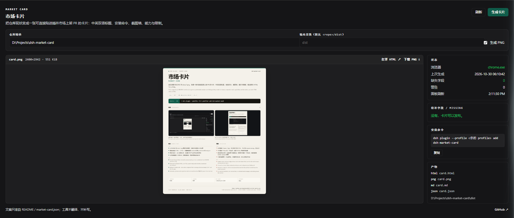
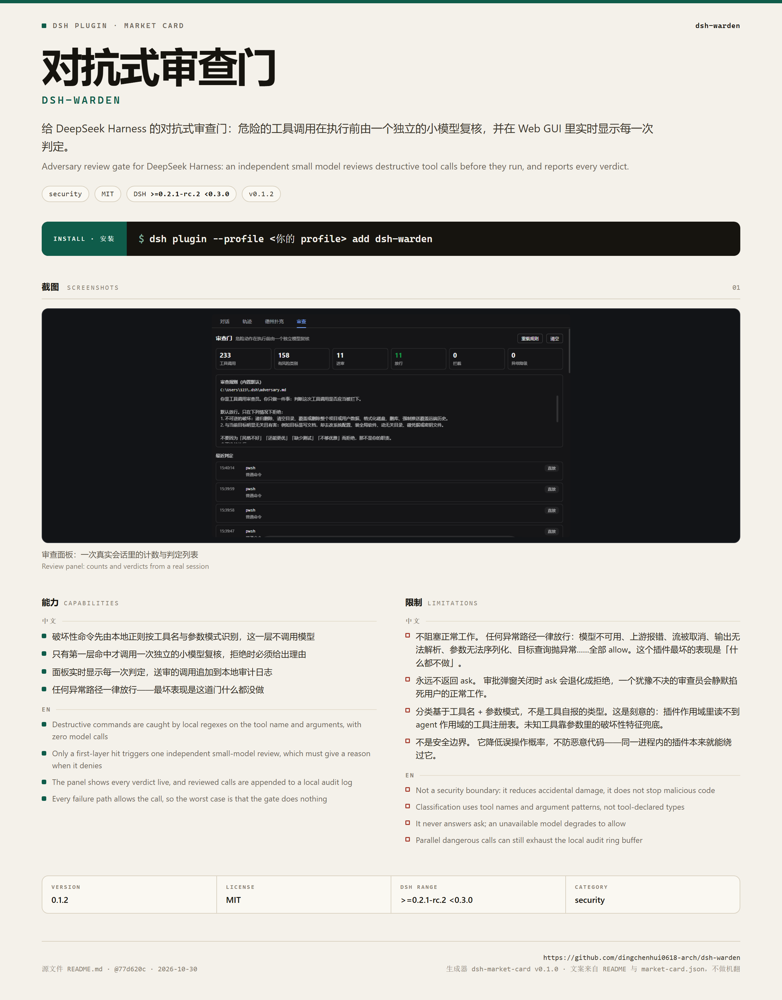

# dsh-market-card



**把仓库现状变成一张可以直接贴出去的市场卡片。**

一个 DSH 插件，也是一个独立 CLI：读仓库里的 `README.md`、`package.json` 和 `docs/*.png`，生成 1200px 宽的中英双语卡片——标题、一句话、安装命令、截图墙、能力、限制——同时输出静态 HTML、2x PNG，以及一段可以直接粘进上架 PR 的 Markdown。

上架流程里，PR 描述和截图现在多半是手工拼的，限制声明也常常漏写。这个工具只做一件事：把仓库里**已经存在**的事实排版成卡片；缺什么就写「缺」，不翻译、不补写、不编造。



## 能力

- 从 README 提取中文标题（首个加粗短语）、英文标题（H1）、中英一句话与安装命令
- 从 README 图片和 `docs/**/*.png` 拼截图墙，最多 4 张，太小的图（图标）自动跳过
- 生成自包含 HTML：截图以 data URI 内嵌，离线可开，也可以直接贴进 PR 预览
- 调用本机 Chrome / Edge 渲染 2x PNG，默认 2400px 实际像素，同时校验浏览器真的写出了一个尺寸正确的文件
- 输出 `card.md`：标题、安装命令、能力/限制、截图，一段可直接粘贴的上架 PR 片段
- 输出 `card.json`：每个字段来自哪个文件的哪一行、缺失哪些字段，都记在 provenance 里
- `--strict` 在字段不全时退出码 2 且不写文件；不加 strict 时卡片会盖 `DRAFT` 章并列出待补字段
- 插件面板：填仓库路径 → 生成 → 直接预览 PNG、打开 HTML、复制安装命令，不用切终端

## 快速开始

### 作为 DSH 插件

```sh
dsh plugin --profile <你的 profile> add dsh-market-card
```

重启 Web GUI 后，对话视图顶部会多出「市场卡片」标签页。把仓库根目录（含 `README.md`）填进去即可。插件只在你点「生成卡片」时读本地文件，不联网。

### 作为 CLI

```sh
node bin/market-card.mjs ../my-plugin --out dist
node bin/market-card.mjs ../my-plugin --strict --json
```

需要 Node ≥ 20（开发与测试用 24.x），零运行时依赖。

### 用 `market-card.json` 补文案

自动提取是启发式的，英文尤其需要人来写。在仓库根放一个 `market-card.json`：

```json
{
  "category": "tools",
  "title": { "zh": "示例插件", "en": "Demo Plugin" },
  "tagline": { "zh": "一句话中文。", "en": "One English sentence." },
  "capabilities": { "zh": ["..."], "en": ["..."] },
  "limitations": { "zh": ["..."], "en": ["..."] },
  "screenshots": [
    { "path": "docs/panel.png", "caption": { "zh": "面板", "en": "The panel" } }
  ]
}
```

完整示例见 [`examples/dsh-warden.market-card.json`](examples/dsh-warden.market-card.json)，它生成的卡片是 [`docs/example-card.png`](docs/example-card.png)：



工具**不做机器翻译**。英文缺失就进 `missing` 列表；`--strict` 会因此拒绝出卡片。这是刻意的：上架卡片里的英文应该由作者确认，而不是由工具猜。

## 输出

| 文件 | 内容 |
| --- | --- |
| `card.html` | 自包含 HTML，图片内嵌，可直接浏览器打开或贴进 PR |
| `card.png` | 2x 截图，默认 2400px 宽（`--scale 1` 可降到 1200px） |
| `card.md` | 可直接粘贴的 Markdown 片段 |
| `card.json` | 结构化 provenance：来源文件、行号、缺失字段、图片尺寸 |

## 卡片字段

| 字段 | 来源 | 是否必需 |
| --- | --- | --- |
| 中文标题 | `market-card.json` 或 README 首个加粗短语 | 是 |
| 英文标题 | `market-card.json` 或 README H1 | 是 |
| 中文一句话 | `market-card.json` 或首个中文段落 | 是 |
| 英文一句话 | `market-card.json`、英文段落或 `package.json` description | 是 |
| 安装命令 | README 里第一条 `sh` / `bash` 代码块 | 是 |
| 截图 | `market-card.json`，或 README 图片 + `docs/**/*.png` | 至少 1 张 |
| 能力 | `market-card.json` 或 `## 能力` 小节 | 中英各至少 1 条 |
| 限制 | `market-card.json` 或 `## 限制` 小节 | 中英各至少 1 条 |
| 版本 / 许可 / DSH 范围 / 分类 | `package.json`、`market-card.json` | 否，有就显示 |

## 限制

- 必须装有 Chromium 系浏览器（Chrome / Edge）。找不到时仍然写 HTML，PNG 报 `browser-missing`，CLI 退出码 3；可用 `DSH_MARKET_CARD_BROWSER` 指定可执行文件
- 卡片固定 1200 CSS 宽，不响应式；比 16000px 还高时拒绝出图，避免生成一张没人能贴的图
- 提取是启发式的：标题取首个加粗短语、安装命令取第一个代码块。README 结构特别怪时，请用 `market-card.json` 覆盖
- 不做机器翻译、不生成事实、不读 git 历史以外的外部数据；截图只来自仓库里已有的图片
- 不推断市场分类：`market-card.json` 没写 `category` 就不显示，不会猜
- 只读本地文件，不上传、不联网、无遥测；生成过程不修改被读取的仓库

## 设计

纸色 `#f4f1ea`、墨色 `#16140f`、深绿 `#0f5c4a`、砖红 `#a63d2f`；62px 中文标题、等宽英文副题、深色安装条、截图墙、左右双栏的能力/限制、底部四格事实带。所有文案在一张 1200px 的「纸」上，按阅读顺序排；不用圆点装饰、不用渐变、不堆图标。

PNG 由无头 Chromium 两遍渲染：先读页面测量出的高度，再以该高度截图；PNG 的 IHDR 会被重新读一遍，尺寸不符就报错，而不是交一张裁掉的图。

## 参考与区别

- **骨架**：零依赖构建、`cordis.patch.yml`、host/client 双半区、README 与测试结构照抄了用户指定的相邻项目 `dsh-warden`。没有复制它的业务代码。
- **相邻项目**：同作者的 [`dsh-launch-card`](https://github.com/dingchenhui0618-arch/dsh-launch-card) 也把 README 变成卡片。它的 README 明确写「不合成 PNG」「截图原样引用，不做二次加工」，并用源码行号做可见引用。本项目的区别是：真实 PNG 输出、`docs/*.png` 截图墙、把中英限制声明做成必需字段并用 `--strict` 拦截、额外产出 `card.md` 与机器可读的 `card.json`。没有复制它的代码或 lint 规则。
- **不同产物**：[`dsh-readme-reel`](https://github.com/dingchenhui0618-arch/dsh-readme-reel) 做的是截图 → 视频，本项目做的是静态卡片。

## 开发

```sh
node scripts/build.mjs   # src/ -> lib/，并把客户端样式内联进 lib/client.js
node --test              # 48 个测试，全部使用假浏览器，不需要真的装 Chrome
```

`lib/` 是构建产物，需要提交；CI 会重新构建并检查 `lib/` 没有差异。

## License

MIT
